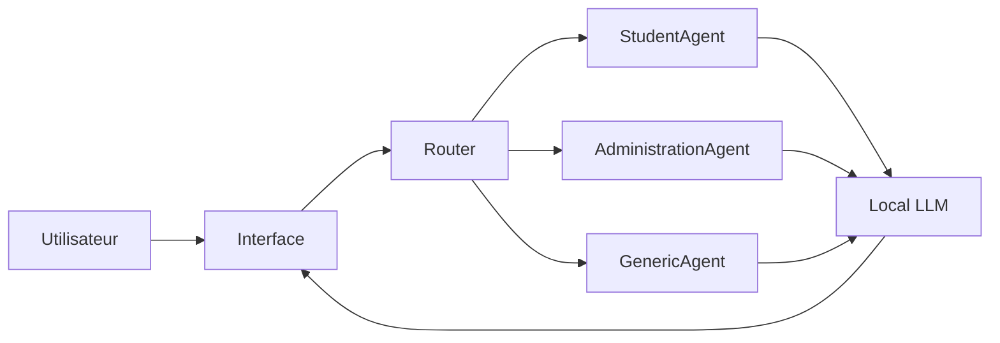
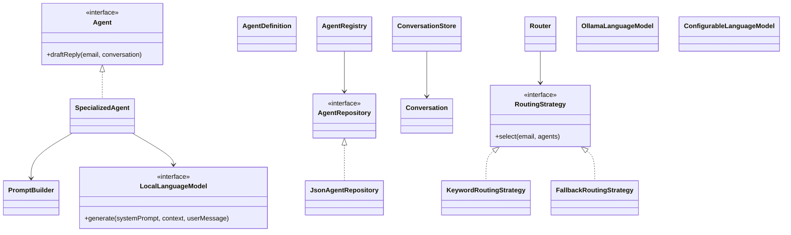
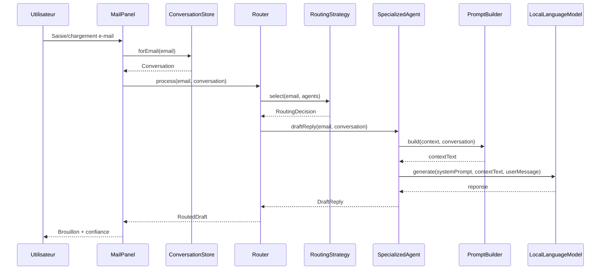

<div align="center">

# Rapport de Projet

## Systeme multi-agents pour l assistance a la redaction d e-mails

### Local Email Agents

</div>

---

**Nom :** Gouriou

**Prenom :** Vikram

**Date :** 29/10/2026

---

## Resume

Ce rapport presente la conception et l implementation d une application Java de generation de brouillons de reponses e-mail basee sur une organisation multi-agents et un LLM local. Le systeme vise a accelerer le traitement des messages tout en conservant un controle humain complet sur la reponse finale. Le rapport decrit le probleme, l architecture, les choix de conception, les mecanismes de routage et de contexte, les tests realises, les resultats, les limites et les perspectives.

## Mots-cles

Multi-agents, LLM local, routage, e-mail, Java, architecture logicielle, prompt engineering.

## Sommaire

1. Probleme etudie  
2. Objectifs du systeme  
3. Organisation multi-agents retenue  
4. Architecture globale de l application  
5. Principaux choix de conception  
6. Classes et interfaces importantes  
7. Mecanismes de communication entre agents  
8. Strategie de routage  
9. Gestion du contexte  
10. Gestion des fils de discussion  
11. Integration du LLM local  
12. Design Patterns utilises et justification  
13. Experiences menees  
14. Resultats obtenus  
15. Limitations de la solution  
16. Ameliorations possibles  
17. Conclusion  
18. Bibliographie  
19. Annexes (diagrammes)

## 1. Probleme etudie

La redaction repetitive de reponses e-mail mobilise du temps et introduit un risque d incoherence de ton ou de contenu. Dans un contexte professionnel ou universitaire, l utilisateur souhaite beneficier d une assistance de redaction sans perdre la maitrise de l envoi, ni exposer ses donnees a des services cloud.

Le probleme traite est donc double :
- automatiser partiellement la production de brouillons pertinents ;
- garantir securite, controle humain et explicabilite des decisions de selection d agent.

## 2. Objectifs du systeme

Objectifs fonctionnels :
- connecter une boite mail en IMAP ;
- router chaque e-mail vers un agent specialise ;
- generer une proposition de reponse contextualisee ;
- permettre validation, edition ou rejet de la proposition ;
- maintenir un historique de conversation pour enrichir les reponses futures.

Objectifs non fonctionnels :
- modularite et extensibilite de l architecture ;
- execution locale du modele de langage ;
- configuration persistante et simple ;
- robustesse face aux erreurs d infrastructure.

## 3. Organisation multi-agents retenue

L organisation retenue repose sur un schema centralise :
- un composant routeur choisit un agent specialise ;
- les agents specialises partagent une structure commune, mais differencient leur role par configuration ;
- un agent de repli est utilise en cas de confiance insuffisante.

Cette approche privilegie la simplicite operationnelle et la maintenabilite, tout en permettant l ajout de nouveaux agents sans duplication de logique metier.

## 4. Architecture globale de l application

L application adopte une architecture en couches :
- couche application : composition des dependances, chargement de configuration ;
- couche domaine : modeles metier et logique d orchestration interne ;
- couche routing : strategie de selection d agent ;
- couche infrastructure : acces LLM local, IMAP/SMTP, persistance JSON ;
- couche UI : interface Swing.

Les dependances suivent un principe de decouplage par interfaces (ports/adapters).

## 5. Principaux choix de conception

Choix majeurs :
- abstraction du LLM via une interface unique ;
- strategie de routage interchangeable ;
- definitions d agents persistables ;
- contexte de prompt structure et borne (historique et documents tronques) ;
- execution asynchrone des traitements lourds cote interface ;
- separation nette entre configuration applicative et donnees sensibles.

## 6. Classes et interfaces importantes

Composants structurants :
- Application : point d entree et assemblage global.
- AppConfig : lecture/ecriture de configuration.
- AgentRegistry : gestion dynamique des definitions d agents.
- AgentDefinition : representation persistable d un agent.
- SpecializedAgent : logique de generation de brouillon.
- PromptBuilder : construction du contexte envoye au LLM.
- Router : orchestration routage puis generation.
- RoutingStrategy / KeywordRoutingStrategy / FallbackRoutingStrategy : politique de selection.
- ConversationStore / Conversation : gestion des fils de discussion.
- LocalLanguageModel / OllamaLanguageModel / ConfigurableLanguageModel : integration du moteur local.
- AgentRepository / JsonAgentRepository : persistance des agents.

## 7. Mecanismes de communication entre agents

La communication est de type orchestrateur -> agent cible (pas de bus inter-agents ni negociations pair-a-pair). Le routeur transmet l e-mail et le contexte conversationnel a un agent unique, qui renvoie un brouillon et des metadonnees de decision (agent, confiance, explication).

Ce mecanisme reduit la complexite de coordination et facilite l explicabilite.

## 8. Strategie de routage

La strategie de base utilise un score lexical par mots-cles :
- poids plus fort pour sujet/expediteur ;
- poids plus faible pour corps de message ;
- conversion du score en confiance ;
- ajustement en cas d ex aequo ;
- fallback vers un agent generic sous un seuil minimal.

Cette strategie est interpretable et peu couteuse, mais moins robuste semantiquement qu un routage vectoriel ou LLM natif.

## 9. Gestion du contexte

Le contexte est compose de trois briques :
- instructions metier ;
- documents de reference ;
- exemples e-mail/reponse.

Le builder de prompt applique des limites de taille :
- nombre maximal de messages d historique ;
- nombre maximal de caracteres de document.

En cas de document non lisible, le systeme degrade proprement avec un message explicite, sans bloquer la generation.

## 10. Gestion des fils de discussion

Les fils sont conserves en memoire via une structure cle -> conversation. La cle est derivee de l expediteur et du sujet normalise (suppression des prefixes de type Re/Fwd/Tr).

Ce choix fournit une coherence conversationnelle simple, mais ne couvre pas tous les cas complexes sans identifiants standards Message-ID/In-Reply-To.

## 11. Integration du LLM local

Le LLM est integre par adaptation HTTP vers Ollama, avec :
- modele et endpoint configurables ;
- timeout configurable ;
- gestion d erreurs explicite.

Un mode demo est disponible pour valider la chaine fonctionnelle sans dependance a un serveur de modele.

## 12. Design Patterns utilises et justification

Patterns observes :
- Strategy : variation de l algorithme de routage sans changer le routeur.
- Decorator : ajout du comportement de fallback autour d une strategie delegatee.
- Factory : centralisation de la creation d agents et de modeles.
- Repository : abstraction de persistance des definitions d agents.
- Proxy : commutation a chaud du delegate LLM.
- Composition Root : point unique d assemblage des objets.

Ces choix favorisent testabilite, extensibilite et separation des responsabilites.

## 13. Experiences menees

Les experiences ont ete menees sous forme de tests automatiques :
- tests de configuration ;
- tests de prompt building ;
- tests de routage ;
- tests de persistance JSON ;
- tests de comportement d agent ;
- test de panneau Courrier.

Commande de campagne de tests :

```bash
mvn test
```

## 14. Resultats obtenus

Resultat de la campagne executee :
- 9 tests executes ;
- 0 failure ;
- 0 error ;
- build success.

Ces resultats valident les mecanismes centraux sur les scenarios couverts. Ils ne constituent pas une preuve exhaustive de qualite en production, mais donnent une base fiable pour les evolutions.

## 15. Limitations de la solution

Limites principales :
- routage lexical sensible a la formulation des messages ;
- historique non persistant entre redemarrages ;
- absence de campagne d evaluation quantitative sur corpus reel ;
- dependance aux performances du modele local ;
- couverture partielle des cas d envoi selon fournisseurs de messagerie.

## 16. Ameliorations possibles

Pistes d amelioration :
- routage semantique (embeddings/LLM classifier) ;
- persistance des conversations ;
- metriques de qualite (precision routage, utilite brouillon, latence) ;
- experimentation A/B sur prompts et modeles ;
- observabilite renforcee des decisions.

## 17. Conclusion

Le projet demontre la faisabilite d une assistance e-mail locale par architecture multi-agents, conciliant productivite et controle humain. L architecture actuelle constitue une base solide pour des evolutions vers un routage plus intelligent, une meilleure persistance du contexte et une evaluation empirique plus large.

## 18. Bibliographie

- Documentation Maven, Apache Maven Project.
- Documentation Java SE 17, Oracle.
- Documentation Ollama API locale.
- Gamma et al., Design Patterns: Elements of Reusable Object-Oriented Software.
- Sources du projet Local Email Agents (code Java et tests).

## 19. Annexes

### Annexe A - Diagramme de l organisation des agents



### Annexe B - Diagramme UML de classes simplifie



### Annexe C - Diagramme de sequence (traitement d un e-mail)


