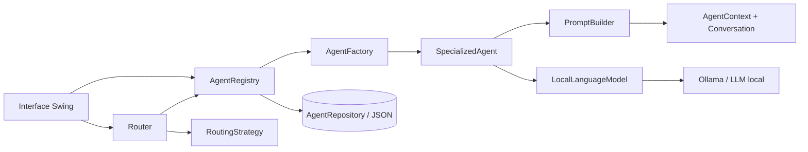
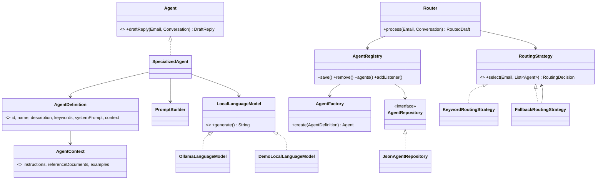
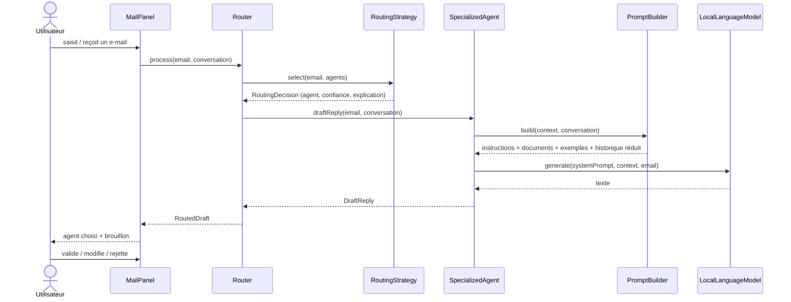

# Architecture

## Vue d'ensemble

## Diagramme de classes (simplifié)

## Séquence : traitement d'un e-mail

## Patterns utilisés et justification

| Pattern | Où | Besoin réel |
|---|---|---|
| Strategy | `RoutingStrategy` | Changer ou ajouter un mode de routage sans toucher au `Router` |
| Decorator | `FallbackRoutingStrategy` | Ajouter le seuil de confiance et le repli autour de n'importe quelle stratégie |
| Factory | `AgentFactory`, `LanguageModelFactory` | Créer les agents depuis leur définition et le LLM depuis la configuration |
| Repository | `AgentRepository` / `JsonAgentRepository` | Isoler la persistance (JSON aujourd'hui, base de données demain) |
| Adapter | `OllamaLanguageModel` | Faire entrer l'API HTTP d'Ollama derrière `LocalLanguageModel` |
| Observer | `AgentRegistry.addListener` | Rafraîchir l'interface quand les agents changent |

## Réponses aux questions de conception

1. **Qu'est-ce qu'un agent ?** Une entité configurée par un `AgentDefinition` (prompt + contexte) qui sait proposer un brouillon via le LLM local.
2. **Responsabilités.** L'agent rédige ; le routeur choisit ; le registre gère le cycle de vie ; l'utilisateur valide.
3. **Informations détenues.** System prompt, instructions, fichiers de référence, exemples mail/réponse, mots-clés.
4. **Communication.** Appels de méthodes typés : `Router` → `Agent` → `LocalLanguageModel`, avec `RoutingDecision` et `DraftReply` comme messages.
5. **Choix de l'agent.** Score de mots-clés (sujet et expéditeur pondérés plus fort que le corps).
6. **Plusieurs agents adaptés.** Égalité de score : la confiance est réduite et l'explication le signale.
7. **Aucun agent adapté.** `FallbackRoutingStrategy` bascule sur l'agent générique sous le seuil `routing.minConfidence`.
8. **Contextes.** `AgentContext` propre à chaque agent.
9. **Historique.** `Conversation` par fil (`ConversationStore`) : message reçu, brouillon généré, réponse validée.
10. **Éviter trop de contexte.** `PromptBuilder` : fenêtre glissante de N messages et documents tronqués.
11. **Nouvel agent.** Formulaire de l'interface ou `AgentRegistry.save(...)` ; aucun code à modifier.
12. **Changer de LLM.** Configuration (`llm.provider`) ou nouvelle implémentation de `LocalLanguageModel`.
13. **Données persistantes.** Définitions d'agents (JSON). À venir : historique des fils.
14. **Avantages / limites.** Spécialisation et contextes courts adaptés aux petits modèles ; routage par mots-clés fragile pour les messages ambigus.
