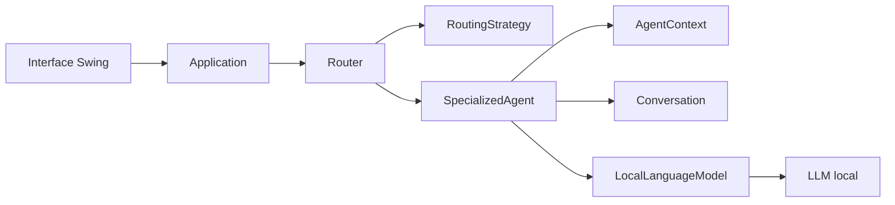

# Architecture initiale

## Principes

- Les agents dépendent de l'interface `LocalLanguageModel`, jamais d'un fournisseur concret.
- La stratégie de routage est remplaçable grâce à `RoutingStrategy`.
- Les contextes et exemples appartiennent à chaque agent.
- La réponse est représentée comme un brouillon et doit être validée par l'utilisateur.
